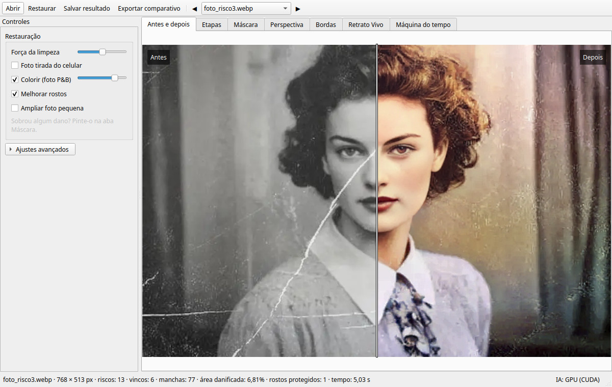
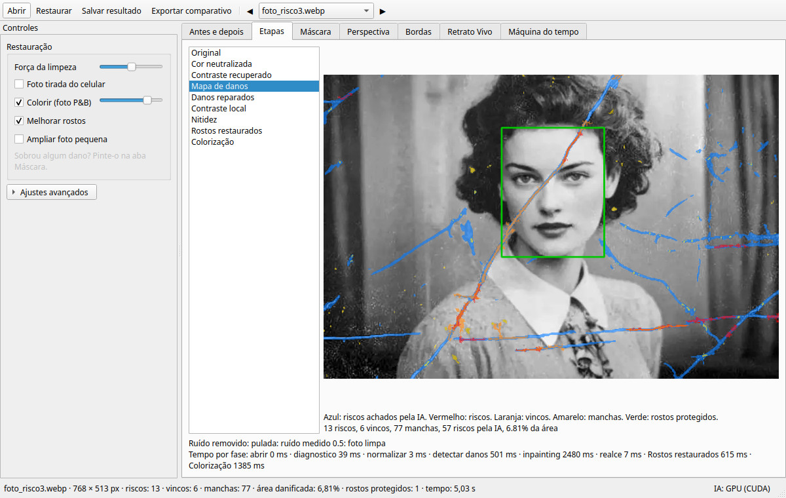
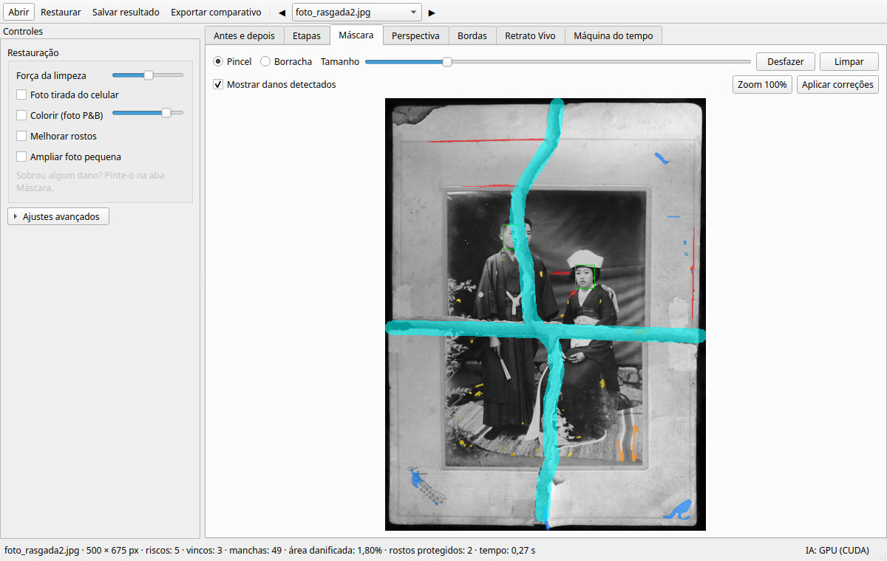
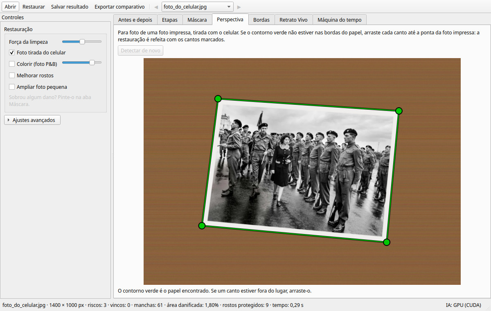
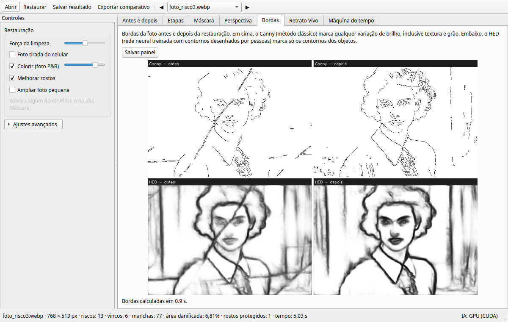
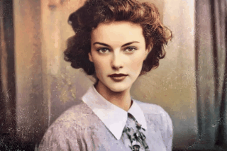
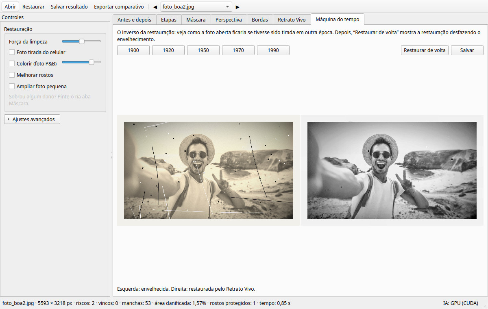

# Retrato Vivo

Restaurador de fotos antigas com OpenCV e Deep Learning. Trabalho final de
**CCC309 – Processamento de Imagens e Visão Computacional** (UPF, 2026/2).

**Equipe:** Igor Zanette · Marco Antonio Santolin · Marcos Paulo de Medeiros

🎬 **Vídeo demonstrativo:** _(em breve)_



## O que faz

- **Mede** a foto (cor, ruído, contraste) e só aplica as correções de que ela precisa.
- Detecta **riscos, vincos e manchas** (morfologia matemática) e os apaga com
  **inpainting**, protegendo os rostos com um detector neural (YuNet).
- Remove amarelado/sépia, recupera o contraste de fotos desbotadas, reduz a granulação
  (Non-Local Means) e realça detalhes (CLAHE + nitidez).
- Explica o que fez: mapa de danos, painel com todas as etapas e o motivo de cada decisão.
- Usa **IA para achar riscos** (rede da Microsoft treinada em fotos antigas) e para
  **reconstruir áreas grandes** como rasgos (LaMa).
- **Colore** fotos preto e branco (DDColor, ICCV 2023, ou Zhang, ECCV 2016) e
  **restaura rostos** (GFPGAN).
- Roda as redes na **GPU (CUDA)** quando houver placa NVIDIA, e na CPU em qualquer PC.
- Tem **interface gráfica**: comparação antes e depois, a foto em cada etapa, ajustes da
  restauração e um editor para corrigir a detecção à mão.
- **Retrato Vivo** (o diferencial): a foto restaurada vira um vídeo com efeito 3D.
- **Máquina do tempo**: uma foto atual vira foto de 1900, 1920, 1950, 1970 ou Polaroid.
- **Amplia** fotos pequenas com super-resolução (ESPCN, rápido, ou EDSR, melhor e mais lento).
- **Desentorta foto de foto**: quem fotografa uma foto impressa com o celular tem o papel torto
  e com a mesa em volta; o sistema acha o papel, corrige a perspectiva e recorta. Se ele errar
  um canto, dá para arrastá-lo na interface.
- **Compara as bordas** antes e depois pelo método clássico (Canny) e por Deep Learning (HED).

## Como rodar (qualquer PC)

Precisa de Python 3.10 ou mais novo e de uns 3 GB livres (bibliotecas + modelos).

**1. Baixar o projeto**
```bash
git clone https://github.com/MrcSanto/retrato-vivo
cd retrato-vivo
```
No Windows, clone numa pasta de caminho curto (por exemplo `C:\Users\voce\Desktop`). Em
pastas muito fundas o `pip` falha com "No such file or directory" ao instalar o PySide6, por
causa do limite de 260 caracteres de caminho do Windows.

**2. Criar um ambiente virtual e instalar as dependências**
```bash
python -m venv .venv
.venv\Scripts\activate             # Windows (no PowerShell: .venv\Scripts\Activate.ps1)
# source .venv/bin/activate        # Linux / macOS
pip install -r requirements.txt
```
No PowerShell, se aparecer "execução de scripts desabilitada", rode antes:
`Set-ExecutionPolicy -Scope Process Bypass`.

**3. Baixar os modelos de IA** (~1,9 GB, só na primeira vez)
```bash
python -m retrato_vivo modelos
```
Se algum download falhar, rode de novo: ele só baixa o que falta.

**4. (Opcional) Usar placa de vídeo NVIDIA**
```bash
pip install "onnxruntime-gpu[cuda,cudnn]"
```
Sem isso tudo funciona igual, só mais devagar (cerca de 4 s por foto na CPU, contra menos de
1 s na GPU). A barra de status da interface mostra onde a IA está rodando.

**5. Abrir a interface**
```bash
python -m retrato_vivo.gui
```
Ela já abre com as fotos de exemplo da pasta `imagens/`.

### Outros comandos

```bash
python -m retrato_vivo restaurar foto.jpg -o saida --painel --explicar   # restaura e explica cada etapa
python -m retrato_vivo restaurar foto.jpg -o saida --colorir --rostos     # com cor e rostos
python -m retrato_vivo restaurar foto.jpg -o saida --ampliar              # super-resolução (--modelo-sr edsr: melhor)
python -m retrato_vivo restaurar foto_do_celular.jpg -o saida --perspectiva   # desentorta foto de foto
python -m retrato_vivo restaurar foto.jpg -o saida --bordas               # painel Canny x HED
python -m retrato_vivo vivo foto.jpg -o saida        # Retrato Vivo: vídeo 3D (MP4 e GIF)
python -m retrato_vivo viajar selfie.jpg -o saida    # Máquina do tempo: todas as épocas
python -m retrato_vivo avaliar foto_boa.jpg          # estraga, restaura e mede PSNR/SSIM
python -m pytest                                     # testes
```

## Interface gráfica

Abra com `python -m retrato_vivo.gui`. Sem argumentos, já abre a primeira foto de `imagens/`
(fotos de exemplo); ◀ e ▶ passam pelas outras fotos da pasta.

1. **Abrir:** clique em "Abrir" (Ctrl+O) ou arraste a foto para a janela. A restauração começa sozinha.
2. **Antes e depois:** arraste a linha branca sobre a foto.
3. **Painel da esquerda:** "Força da limpeza", "Foto tirada do celular" (desentorta o papel),
   "Colorir", "Melhorar rostos" e "Ampliar foto pequena". O resto (modelo de cor, ESPCN ou EDSR
   etc.) fica em "Ajustes avançados". A restauração é refeita sozinha quando você para de mexer.
4. **Etapas:** a foto em cada ponto do processamento e o que cada etapa decidiu.
5. **Máscara:** pinte com o pincel o que a detecção não pegou (rasgos, por exemplo) e clique em
   "Aplicar correções". A borracha desmarca o que foi marcado por engano.
6. **Perspectiva:** com "Foto tirada do celular" marcada, o contorno verde mostra o papel
   encontrado. Se um canto ficou fora do lugar, ou se o papel não foi achado, arraste os cantos
   até as pontas da foto impressa. "Detectar de novo" volta à detecção automática.
7. **Bordas:** Canny (clássico) e HED (rede neural), antes e depois da restauração.
   O clássico marca qualquer textura; a rede marca só os contornos dos objetos.
8. **Retrato Vivo:** "Criar Retrato Vivo" transforma a foto restaurada num vídeo 3D; salve em MP4 ou GIF.
9. **Máquina do tempo:** escolha uma época; "Restaurar de volta" mostra a restauração desfazendo o
   envelhecimento.
10. **Salvar:** "Salvar resultado" (Ctrl+S) e "Exportar comparativo".

A barra de status mostra os danos encontrados, o tempo e se a IA está rodando na GPU ou na CPU.

### Capturas de tela

Feitas com as fotos de exemplo da pasta `imagens/`.

| | |
|---|---|
|  **Etapas:** o mapa de danos da foto riscada. Azul e vermelho são riscos, laranja são vincos, amarelo são manchas e o quadro verde é o rosto protegido. |  **Máscara:** o rasgo pintado com o pincel (em ciano), por cima do que a detecção achou. |
|  **Perspectiva:** o contorno verde é o papel encontrado; cada canto pode ser arrastado. A foto de exemplo foi simulada como foto de celular. |  **Bordas:** Canny em cima e HED embaixo, antes e depois da restauração. |
|  **Retrato Vivo:** a foto restaurada e colorida vira um vídeo com efeito 3D. |  **Máquina do tempo:** uma selfie vira foto de 1920 (à esquerda) e é restaurada de volta (à direita). |

## Documentação

- **[docs/COMO_FUNCIONA.md](docs/COMO_FUNCIONA.md)**: o que cada arquivo e cada etapa faz.
- **[docs/DIFERENCIAL.md](docs/DIFERENCIAL.md)**: Retrato Vivo e Máquina do tempo, e o roteiro da apresentação.
- **[docs/FLUXO_DE_TRABALHO.md](docs/FLUXO_DE_TRABALHO.md)**: divisão de tarefas, prazos e regras para contribuir.
